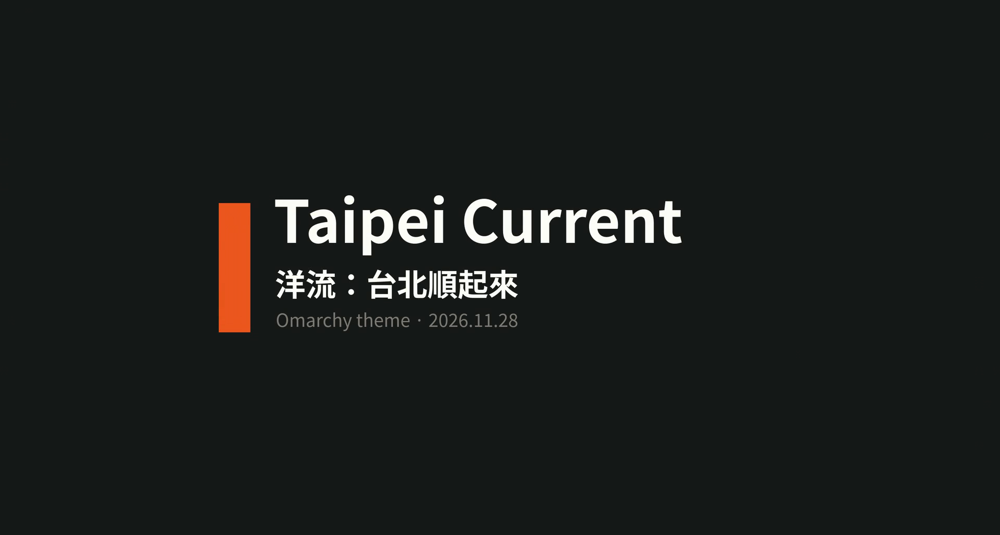
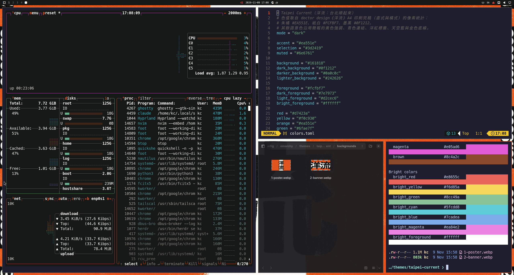
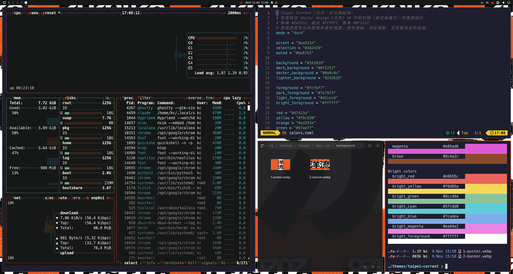
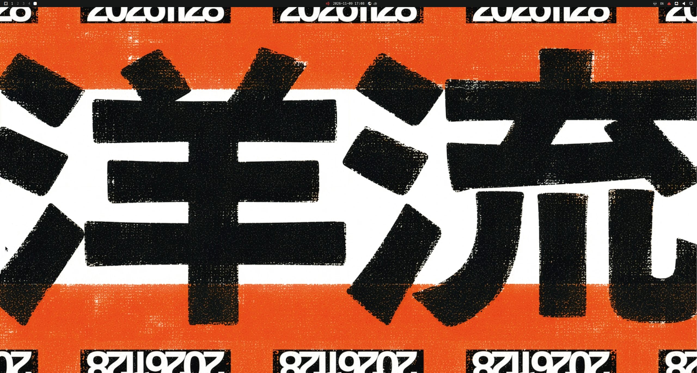
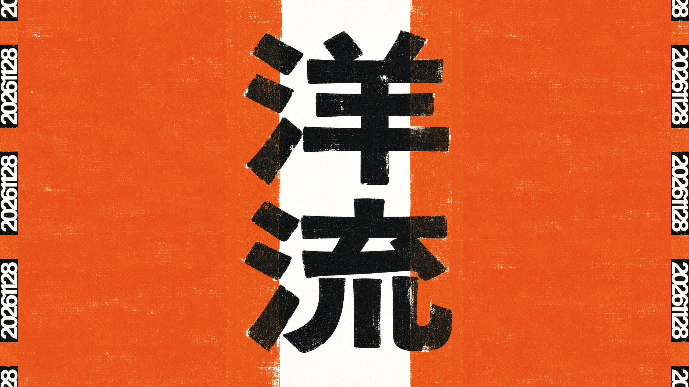
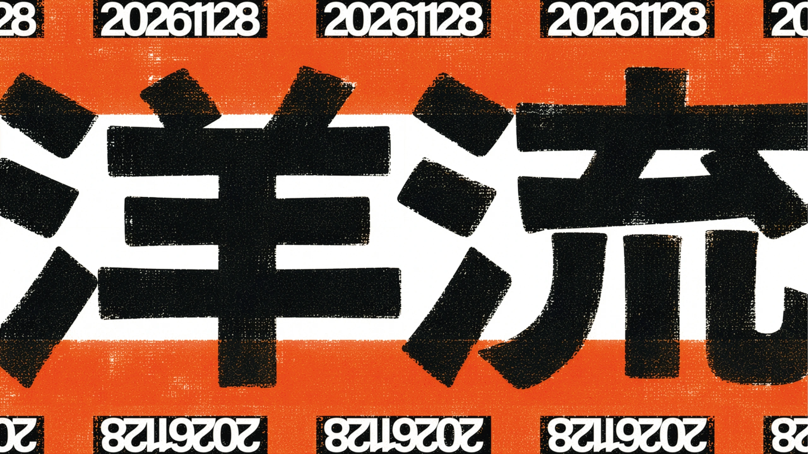
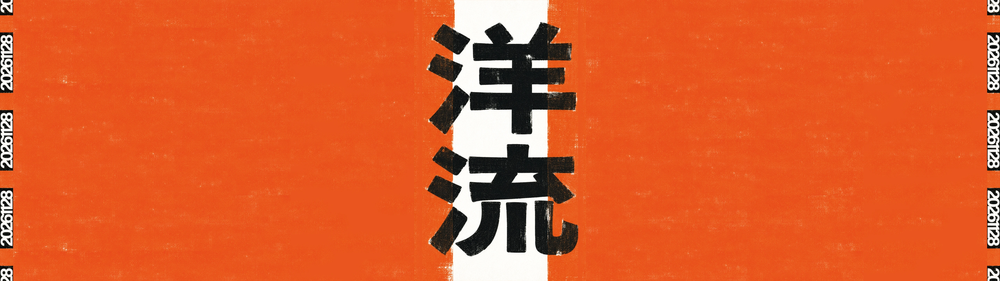
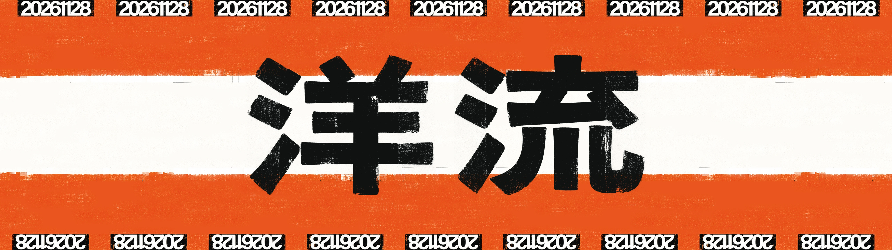
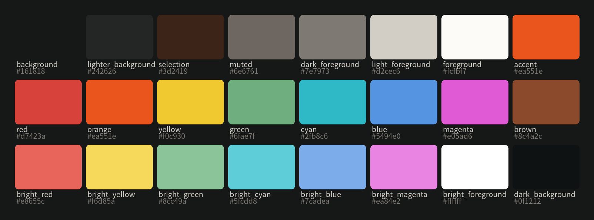
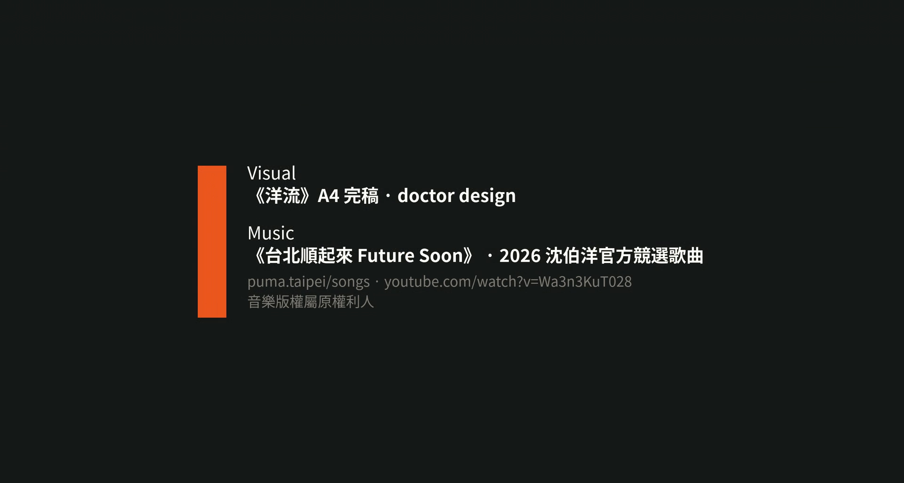

# Taipei Current · 洋流：台北順起來

一套 [Omarchy](https://omarchy.org) 主題。朱橘、紙白、墨黑三色，色值與桌布都取自 doctor design 的《洋流》A4 印刷完稿，
把印刷品的粗獷版畫質感原封不動搬到 Hyprland 桌面上。




## Install

```bash
omarchy theme install https://github.com/kcchien/omarchy-taipei-current-theme
```

一行裝完並直接套用。之後用主題選單（`Super + Ctrl + T`）切換，或：

```bash
omarchy theme set taipei-current   # 套用
omarchy theme bg next              # 切換兩張桌布
```

## Screenshots

以下畫面均取自上面的示範影片。海報桌布配 btop、Neovim、Files 與 `omarchy dev theme preview` 的調色盤：



橫幅桌布：





## Video

帶片頭、片尾與配樂的完整版（1920x1028、約 34 秒）：[videos/taipei-current-theme.mp4](videos/taipei-current-theme.mp4)

配樂是 2026 沈伯洋官方競選歌曲《台北順起來 Future Soon》（[puma.taipei/songs](https://puma.taipei/songs)），音樂版權屬原權利人。

## Wallpapers

兩張 2560x1440 桌布都不是重畫的，是直接取用印刷完稿的像素：

| | |
|---|---|
|  |  |
| **1-poster**（另有 5120x1440 的 **3-poster-ultrawide**）：直式完稿的構圖。白帶居中、洋流兩字直排、橘底在兩側、左右外緣保留 20261128 日期條。16:9 多出來的橘底是用橫式完稿裡沒有文字的兩段橘色版面拼成，羽化重疊、同一縮放比例，印刷顆粒紋理與原稿一致。 | **2-banner**：橫式完稿本身。只抽掉文字上下各一段純橘版面湊成 16:9，上下日期條與洋流兩字完整保留。 |

### 超寬螢幕（32:9）

Omarchy 以「保持比例、裁切填滿」的方式鋪桌布，16:9 的圖在 5120x1440 螢幕上會被裁掉上下、洋流兩字被切到。
超寬螢幕請改用 5120x1440 的兩張：

```bash
omarchy theme bg set ~/.config/omarchy/themes/taipei-current/backgrounds/3-poster-ultrawide.webp
omarchy theme bg set ~/.config/omarchy/themes/taipei-current/backgrounds/4-banner-ultrawide.webp
```

- **3-poster-ultrawide**：海報構圖，兩側橘底以同一套印刷紋理延伸。
- **4-banner-ultrawide**：橫幅構圖重排。橫式原稿的洋流兩字左右出血裁到紙邊，無法直接拉寬，所以改從直式原稿取出完整的兩個字改為左右並排，白帶、橘底、毛邊與日期條全部取自兩張原稿沒有筆畫的區段拼成。

| | |
|---|---|
|  |  |

## Palette

三個主色是完稿像素統計的結果，不是目測取色：

| 角色 | 色值 | 來源 |
|---|---|---|
| accent / orange | `#ea551e` | 完稿的朱橘版面 |
| foreground | `#fcfbf7` | 完稿的紙白帶 |
| background | `#161818` | 完稿的墨黑筆畫 |

其餘語意色（紅、黃、綠、青、藍、洋紅、棕）為終端機與程式碼高亮補上可讀的對比，與主色在同一個暗色調裡。



## What is inside

```
colors.toml        # 色票；Omarchy 由此產生終端機、Neovim、btop、Hyprland 等所有程式的配色
backgrounds/       # 兩張桌布
unlock.png         # 鎖定畫面的解鎖字標（朱橘）
icons.theme        # 圖示主題（Yaru）
preview.mp4        # 主題選單的動態預覽
```

主題只帶 `colors.toml` 與靜態資產，沒有任何可執行的設定檔。Omarchy 會在套用時用自己的樣板把色票展開成各程式的設定，
所以升級 Omarchy 不需要更新主題。

## Credits



- 視覺：《洋流》A4 完稿，doctor design。本主題是以該視覺製作的桌面配色，圖像著作權屬原作者。
- 配樂：《台北順起來 Future Soon》，2026 沈伯洋官方競選歌曲，音樂版權屬原權利人。
- 製作：Taipei Current 主題的色票、桌布裁切與預覽由 kcchien 製作。
